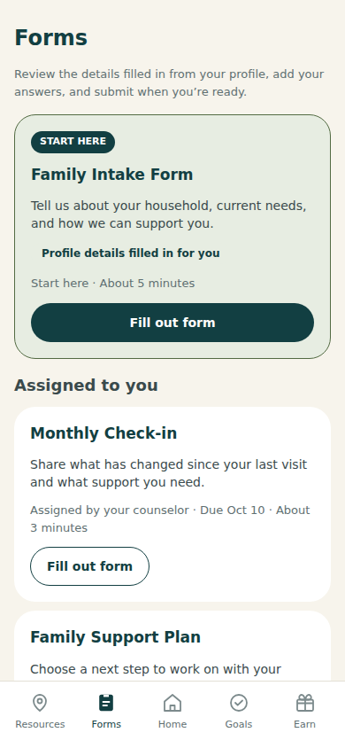
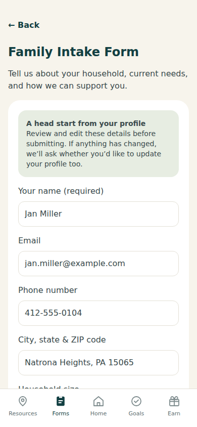
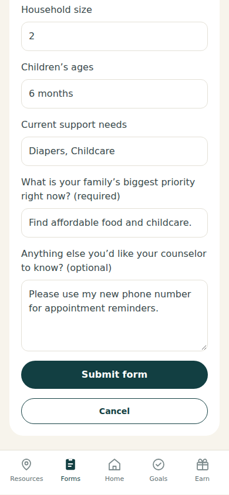
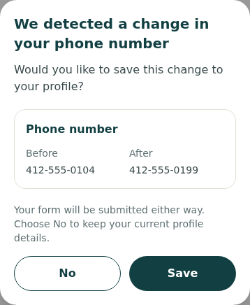
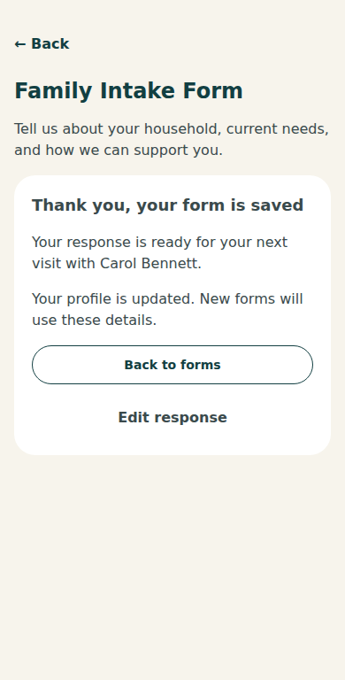

# COMP 451: Cognitive Walkthrough

**Joshua Smullen**  
**October 21, 2026**

## Representative Task

Complete the Family Intake Form in the mother-facing MotherCare prototype. Review the prefilled information, correct the outdated phone number, describe the family's priorities, and submit the response. Update the profile during submission so future forms use the corrected number.

The task begins on the Home screen with the default Jan Miller record and no submitted intake response. Jan changes her phone number from 412-555-0104 to 412-555-0199 and identifies food and childcare as her family's priorities. Success means that the response is submitted, the saved answers can be reviewed, and the profile contains the corrected phone number.

## Hypothetical User

Jan is a mother preparing for an appointment. She uses her phone to complete online forms, knows her current contact and household information, and has limited time before her appointment.

## Cognitive Walkthrough

The following eight steps organize Jan's actions, the information that guides her, and the feedback that helps her recognize progress.

### Find the form

| Step | User action | Information available | Feedback and interpretation |
| --- | --- | --- | --- |
| **1. Open Forms** | From Home, Jan selects **Forms** in the bottom navigation. | The visible label matches her counselor's request to complete a form. | The Forms heading and form cards appear, confirming that she has reached the correct page. |
| **2. Select Family Intake Form** | Jan selects **Fill out form** on the Family Intake Form card. | The highlighted card includes a **START HERE** badge, a description, and a time estimate. These cues distinguish intake from the other forms. | The intake form opens with prefilled profile information and a matching title, helping Jan recognize that she selected the correct form. |

Figure 1 shows the highlighted intake card and the cues that guide Jan toward the correct form.

### Review and enter information

| Step | User action | Information available | Feedback and interpretation |
| --- | --- | --- | --- |
| **3. Review prefilled details** | Jan reviews the supplied information, leaves accurate details unchanged, and replaces 412-555-0104 with 412-555-0199. | A panel explains that her profile information has been filled in and recommends reviewing it in case anything has changed. | Jan checks the information instead of assuming it is current. The phone field displays her corrected number. |

Figure 2 shows the explanation and prefilled fields before Jan corrects her phone number. The panel encourages her to review the supplied information.

| Step | User action | Information available | Feedback and interpretation |
| --- | --- | --- | --- |
| **4. Complete the remaining questions** | Jan scrolls through the rest of the prefilled information, confirms it is accurate, and answers the question about her family's current priority. She enters that they need help with food and childcare. | The form extends beyond the initial screen, so she must scroll to reach the remaining questions. Required and optional labels help her distinguish what she needs to complete. | Her answers remain visible in their fields, allowing her to review them before submitting. |

Figure 3 shows the completed priority answer and the submission controls at the bottom of the form, which Jan reaches by scrolling.

### Submit the form

| Step | User action | Information available | Feedback and interpretation |
| --- | --- | --- | --- |
| **5. Submit the completed form** | Jan selects **Submit form** at the bottom of the form. | The filled Submit form button follows the questions, with **Cancel** below it. Jan must choose the submission action. | A phone-change dialog opens instead of a success message. It explains that the number she entered differs from her previous number. The introductory panel has warned that this additional prompt may appear. |
| **6. Save the corrected number for future forms** | Jan compares the old and new numbers, then selects **Save** in the dialog. | The dialog asks whether to update her profile and displays both numbers together. | Jan must understand that Save submits the response and updates her profile number. Selecting it closes the dialog and displays the completion message. |

Figure 4 shows the old and new phone numbers together and asks whether Jan wants to save the change to her profile.

### Confirm completion

| Step | User action | Information available | Feedback and interpretation |
| --- | --- | --- | --- |
| **7. Recognize that the task succeeded** | Jan reads the completion message. | “Thank you, your form is saved” confirms the response. A separate sentence says that her profile is updated and future forms will use the new details. The screen names her counselor and offers **Back to forms** and **Edit response**. | Jan must notice both confirmations to understand that her form is complete and her profile has been updated. |
| **8. Return and review the saved response** | Jan selects **Back to forms**. She can then select **Review form** to reopen her response. | The intake card displays a submitted status and offers Review form instead of Fill out form. Reopening it shows the saved answers, including the corrected number and family priority. The submission button now reads **Save changes**. | Jan can recognize that the form is complete without having to remember her earlier actions, and she can review the retained answers. |

Figure 5 shows the separate confirmations that the form is saved and the profile is updated, along with the options to return to Forms or edit the response.

### Alternative paths

#### Submit with required answers missing

If Jan tries to submit without completing a required question, the form directs her to the first unanswered required question. She must supply that answer before proceeding.

#### Decline the profile update

If Jan selects **No** in the phone-change dialog, the edited number is saved in the form response, while her profile keeps the old number. This is a valid choice when she wants the change to apply only to the response, but it does not complete this task's requirement to update her profile too.

#### Leave before submitting

If Jan edits a prefilled field or adds an answer, then selects Cancel or leaves the form, her unsent changes are discarded. The app leaves the form without a discard warning, so reopening it does not restore those changes. Jan could lose her work if she leaves unexpectedly.

## Analysis

### Visible navigation and grouping

The labeled tabs at the bottom let Jan connect her goal to a visible action without having to interpret unfamiliar navigation. On the Forms page, the intake card's position, color, and START HERE badge reinforce which form she should complete (Figure 1). The distinction between the cards reduces the need to inspect every available form.

### Prefilling reduces effort

Prefilling from the profile reduces cognitive load and repetitive typing, but Jan still needs to review the information. The introductory panel explains where the details come from and invites corrections. The submission controls and remaining questions appear farther down the form, so Jan must scroll to reach them. Required and optional labels help her distinguish what she needs to complete.

### Confirmation of changes to prefilled information

The before-and-after comparison displays both the old and new phone numbers, reducing memory demands and helping Jan catch mistakes (Figure 4). However, she still needs to understand what No and Save do after she selects Submit form. No keeps the corrected number in the response but leaves her profile unchanged. Save keeps the corrected number in both the response and her profile.

## Proposed Improvements

### Make submission outcomes clearer

Keep the before-and-after comparison in Figure 4, but replace the current buttons with three clearly labeled options: **Submit and update profile**, **Submit without updating profile**, and **Back to form**. These labels would make the submission choices clearer and give Jan a way to return to the form if she made a mistake.

### Confirm before discarding unsent answers

When Jan has unsent changes and selects Back or another navigation destination, show a confirmation asking, **“Discard your unsent answers?”** Offer **Keep editing** and **Discard answers**. Keep editing should preserve the form as it was before she tried to leave. Discard answers should remove the unsent changes and return the form to its previous state. Apply the same confirmation to Cancel so Jan has a chance to keep her work before it is discarded.
